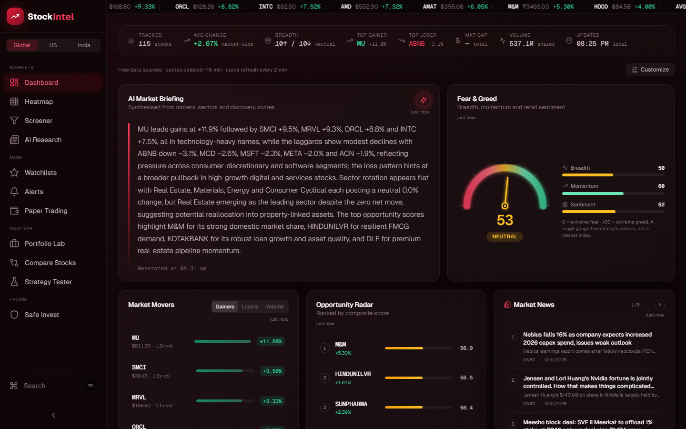
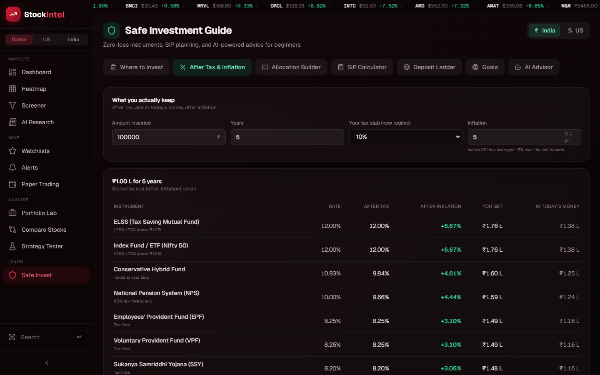

# StockIntel: A Data Study of US and Indian Stocks, and What Savers Actually Keep

An analysis project that asks two practical questions with public market data. First, how did a broad set of US and Indian stocks actually behave over the past year: returns, volatility, drawdowns and how much they move together? Second, for an Indian saver choosing between FDs, PPF, index funds and stocks, what return is left after tax and inflation? Daily prices for 160 tracked stocks (97 US, 63 NSE) plus benchmarks are collected twice a day, cleaned, and joined with mutual fund NAVs, government savings rates, official economic release dates, analyst ratings, insider filings, news and earnings calendars. A weekly job recomputes the market statistics behind the Findings, which the Market Study page charts; the rest of the dashboard (screeners, a portfolio optimizer, stress tests, a strategy backtester, and calculators) turns the findings into decisions.

Built with Python (pandas, NumPy, SciPy, statsmodels), FastAPI, PostgreSQL, Redis, Next.js and Recharts, on public data (Yahoo Finance via yfinance, Finnhub, Twelve Data, AMFI NAVs via mfapi.in, FRED) with scheduled GitHub Actions pipelines.

> **What it's for:** see what the data says about risk and return in US and Indian markets, compare savings options by what you actually keep, and test your own ideas (a watchlist, a portfolio, a trading rule) against real history before trusting them.

**Live demo:** [stock-market-intelligence-sable.vercel.app](https://stock-market-intelligence-sable.vercel.app)





---

## Disclaimer

**This project is for education and analysis only. It is not financial, investment or tax advice.** Nothing here is a recommendation to buy, sell or hold any security. Scores, forecasts and "opportunity" rankings are outputs of simple statistical models and can be wrong. Market data comes from public APIs and can be delayed, incomplete or incorrect, and tax rules are simplified. No brokerage account is connected and no real trades are placed. See Honest Limitations for specifics.

---

## Findings

Numbers below are from 13 Nov 2025 to 13 Nov 2026 (260 trading days) unless stated, using adjusted daily closes for the tracked universe. They match the weekly run stored on 13 Nov 2026; the [Market Study page](https://stock-market-intelligence-sable.vercel.app/study) always shows the latest week. Medians are across stocks in each market.

**Markets**

| Measure | US (97 stocks) | India (63 NSE stocks) |
|---|---|---|
| Median 1-year return | **+13.6%** | **+1.5%** |
| Share of stocks that rose | 68% | 52% |
| Median annualised volatility | 34.6% | 25.3% |
| Median maximum drawdown | -28.9% | -25.5% |
| Benchmark | S&P 500 ETF (SPY) +13.3% | Nifty 50 -2.2% |

- **The year split sharply by market.** Two thirds of the US names rose and the median US stock slightly beat the S&P 500. In India the typical stock was flat and the Nifty 50 fell 2%, so a diversified Indian equity holder ended the year about where they started, before inflation.
- **US stocks were riskier, not just better.** The median US stock swung 37% more than the median Indian one (34.6% vs 25.3% annualised) and had a deeper worst fall. Part of that is the tracked US list itself, which leans towards high-beta technology, crypto-linked and recent IPO names; see Honest Limitations.
- **Even "good" years contain deep falls.** The median stock in both markets fell more than 25% from a peak at some point in the year. Anyone who sizes a position assuming a smooth ride will sell at the bottom.
- **US and Indian stocks look unrelated on the same day, but not the next day.** Equal-weighted daily returns of the two markets correlate at just **0.03** on the same date, which looks like perfect diversification. Pair each US session with India's *next* session instead and the correlation rises to **0.29**, and on the 49 biggest US days (top fifth by size of move) Indian stocks moved the same way at their next session **75.5%** of the time. The NSE closes before New York opens, so US news reaches Indian prices a day later. The Market Study page charts this.

**Saving and investing in India**

- **A 7% bank FD in the 30% slab loses money in real terms (-0.1% a year)** once 5% inflation is counted, while PPF at 7.1% tax-free keeps +2.0% a year. The headline rate ranks them almost equally; the after-tax, after-inflation rate does not. This is what the After Tax and Inflation tab computes for every instrument.
- **Direct mutual fund plans beat Regular plans of the same fund by 0.5 to 0.85 percentage points a year**, measured from AMFI NAVs over five years: Parag Parikh Flexi Cap 11.69% vs 10.84%, HDFC Flexi Cap 16.80% vs 16.04%, UTI Nifty Next 50 Index 11.26% vs 10.76%. The fund and its holdings are identical; the gap is the distributor commission inside the Regular plan's expense ratio.

**Data quality: what the pipeline had to fix**

- **The free US quote feed reports zero volume for every stock.** Finnhub's free quote endpoint has no volume field, so "volume vs average" and unusual-activity detection silently read 0 for all 97 US names. Volume and the 20-day average are now taken from the daily history instead.
- **No free source gives live NSE quotes to a cloud server.** Yahoo blocks requests from Render's IP range, and the keyed APIs cover US listings only. Indian prices therefore come from the scheduled history sync: the latest close, plus a delayed midday snapshot during the session, and every such price is labelled.
- **A fallback that "succeeds" with fake data hides outages.** The original Yahoo adapter returned sample data instead of raising an error, so the provider chain never tried the next source and the site showed plausible but invented prices. The API now counts sample data served (`mock_served` on `/health`), refuses to fire alerts or fill paper trades on it, and badges it in the UI. Production currently serves none.
- **Tickers change under you.** Four tracked symbols were renamed or split during the year (SQ to XYZ, LTIM to LTM, MAZAGON to MAZDOCK, and Tata Motors demerging into TMPV and TMCV), each silently turning into missing data until the symbol map was updated.
- **Some dashboard cards were filling gaps with invented data.** Insider Activity topped itself up with generated trades when real filings were scarce, and labelled stock grants and option exercises as "buys"; "Top Analyst Picks" turned the app's own score into Strong Buy and Sell labels; the economic calendar guessed release dates; sector "net institutional flow" was always zero because the free quotes carry no market cap. Each now uses real data (SEC Form 4 codes, Finnhub analyst recommendation trends, FRED release dates, today's average move and breadth) or shows less rather than guessing.
- **Scheduled jobs don't run on schedule.** Across ten measured runs, GitHub started this repo's scheduled sync 3.6 to 10.5 hours late. The "midday" NSE run is scheduled at 02:00 UTC so that, with typical delays, it lands inside the 03:45 to 10:00 UTC trading session.

---

## Features

### Market Analysis

- **Market Study:** the Findings as an interactive page: US vs India table, distribution of 1-year returns, a risk vs return scatter of every stock, median return by sector, global cues (same-day vs next-session correlation) and the savers' comparisons. Recomputed weekly.
- **Dashboard:** AI market briefing generated from the day's movers, sector rotation and discovery scores; fear and greed gauge built from breadth, momentum and retail sentiment; movers by gain, loss and volume; opportunity radar; news from seven financial feeds sorted by publish time.
- **Heatmap:** sectors and stocks sized by market cap and coloured by daily change.
- **Screener:** filter the universe by change, RSI, volume ratio, P/E and market cap, with preset strategies.
- **Search any stock:** any US, NSE or BSE listing, not only the tracked 160; untracked stocks join the daily history sync once someone adds them to a watchlist.
- **Data provenance on every price:** each quote is tagged live, delayed, end-of-day or sample, and the UI badges anything that is not live.
- **Context cards:** Wall Street analyst consensus (with monthly upgrades and downgrades), US insider filings classified by SEC transaction code, official US economic release dates with the S&P 500's measured average move on past release days, and sector rotation by momentum, average move and breadth.

### Stock Research

- **"Why is it moving?":** an AI explanation of the day's move grounded in price, volume, technicals and recent headlines, with the evidence it used and a confidence level.
- **Technicals, fundamentals and a SARIMA forecast** with 80% and 95% intervals (falls back to a linear and Holt smoothing ensemble when the fit doesn't converge).
- **Upcoming earnings and dividend dates**, synced daily, and a side-by-side comparison of up to six stocks.

### Portfolio Analysis

- **Import your holdings:** upload a broker CSV (Zerodha, Upstox, or any file with symbol, quantity and average cost). It is parsed in the browser; only tickers and quantities are sent to be priced, and nothing is stored.
- **Optimizer:** mean-variance optimisation (SciPy SLSQP) with an efficient frontier, five allocation strategies, a 2,000-path Student-t Monte Carlo, a correlation matrix, six historical crash stress tests and a rebalancer.
- **Strategy tester:** backtest RSI, MACD, moving-average and Bollinger rules with equity curves, Sharpe ratio, maximum drawdown and alpha against buy-and-hold.
- **Paper trading:** virtual USD and INR accounts at real (delayed) prices, with a daily performance chart against the S&P 500 or Nifty 50 rebuilt from the trade log.

### Saving and Investing (India and US)

- **45 instruments** (33 Indian, 12 US) with official government small-savings rates for the current quarter, a warning once that quarter has ended, and live trailing returns for 12 mutual fund categories from AMFI NAVs.
- **After tax and inflation:** what each instrument returns after your tax slab and inflation, in today's money.
- **My mutual funds:** track the funds you hold at the latest NAV, with 1, 3 and 5-year returns and a NAV history.
- **Calculators:** SIP with step-up, lump sum vs spreading out, FD or CD ladder, goal planner with saved goals and an emergency-fund preset, allocation builder, and an AI Q&A for beginners.
- **Learn the basics:** six short lessons and a searchable glossary of every term the app uses.

### Watchlists and Alerts

- **Watchlists** with live quotes, upcoming earnings and dividend dates, and a weekly recap (five-day moves plus a short AI summary).
- **Price alerts** checked in the background each market refresh, delivered as Web Push notifications to phone or desktop even with the site closed.
- **No accounts:** each browser gets an anonymous identity, and a one-time code (or QR code) links a second device to the same data.

### UI

Dark "terminal" layout with glass cards, a grouped sidebar, a US / India / Global market switch and `Ctrl-K` search. Installable as an app. Works at phone width, respects reduced-motion settings, shows a retry state instead of loading forever, and explains every metric in a tooltip.

---

## Data Source

| Source | Type | API Key? | What It Provides |
|--------|------|----------|-------------------|
| [Yahoo Finance](https://finance.yahoo.com) via [yfinance](https://github.com/ranaroussi/yfinance) | Python library, run in GitHub Actions | No | ~400 days of daily OHLCV for US and NSE stocks and benchmarks; earnings and dividend dates |
| [Finnhub](https://finnhub.io) | REST | Yes | US real-time quotes, symbol search, company profiles, basic fundamentals, company news |
| [Twelve Data](https://twelvedata.com) | REST | Yes | Backup US daily history for symbols the sync missed |
| Finnhub recommendation trends and insider transactions | REST | Yes (same key) | Monthly analyst rating counts; SEC Form 4 insider filings |
| [FRED](https://fred.stlouisfed.org/docs/api/fred/) (St. Louis Fed) | REST | Yes (free) | Official release calendar for CPI, jobs, GDP, PCE, PPI, retail sales, housing starts and jobless claims |
| Federal Reserve | Published schedule | No | FOMC meeting dates (next year's marked tentative) |
| [mfapi.in](https://www.mfapi.in) (AMFI NAV files) | REST | No | Daily NAV history for every Indian mutual fund scheme |
| [US Treasury FiscalData](https://fiscaldata.treasury.gov) | REST | No | Treasury bill rates |
| India Ministry of Finance notifications | Curated quarterly | No | Small-savings rates (PPF, SCSS, SSY, NSC, KVP, POMIS and others) |
| WSJ, CNBC, Economic Times, Mint, Business Standard, Moneycontrol | RSS | No | Market headlines with publish times |
| Reddit, StockTwits, Google Trends | REST | Reddit: yes | Retail attention and sentiment |
| [Groq](https://groq.com) (gpt-oss-120b) | LLM API | Yes | Briefings, "why is it moving" explanations, research summaries, watchlist recaps |

**Cleaning and joining:** daily bars are stored per symbol and rejected when older than five days; quotes from all sources are normalised to one schema with a source tag; NSE symbols are stored without the `.NS` suffix for tracked stocks and with it for others, so the two never collide; renamed tickers are remapped; Indian and US prices are kept in their own currency and never converted. Mutual fund returns use Growth-option NAVs (IDCW NAVs drop at each payout and would understate returns).

---

## Tech Stack

| Layer | Technology | Details |
|-------|-----------|---------|
| **Analysis** | pandas, NumPy, SciPy, statsmodels | Returns, volatility, drawdowns, correlation (`scripts/market_findings.py`), SLSQP optimisation, Monte Carlo, SARIMA |
| **Data pipeline** | GitHub Actions + yfinance | Scheduled history and events sync into Redis (twice a day plus a midday NSE run) and a weekly Market Study job |
| **API** | FastAPI (async Python) | Provider fallback chain with circuit breakers, caching, OpenAPI docs at `/docs` |
| **Storage** | PostgreSQL (Neon), Redis (Upstash) | Watchlists and paper trades in Postgres; price history, quote cache and alerts in Redis |
| **AI** | Groq (gpt-oss-120b) or local Ollama | OpenAI-compatible API, auto-switches if a model is retired |
| **Frontend** | Next.js 14, React 18, TanStack Query, Recharts, Tailwind | Dashboard, charts and calculators |
| **Notifications** | Web Push (VAPID) + service worker | Price alerts with the site closed |
| **Testing** | pytest, Playwright | Unit and API tests; browser smoke tests at desktop and phone sizes |
| **Hosting** | Vercel (web), Render (API) | See `docs/DEPLOY-FREE-TIER.md` |

---

## Prerequisites

- **Python 3.12+**: [Download here](https://python.org/)
- **Node.js 20+**: [Download here](https://nodejs.org/)
- **Docker Desktop** (optional, for the one-command local stack): [Download here](https://www.docker.com/products/docker-desktop/)
- **Ollama** (optional, for local AI): [Download here](https://ollama.ai/)

---

## Quick Start

### Docker (one command)

```bash
docker compose -f infra/docker-compose.yml up --build
```

Opens the web UI on http://localhost:9000 and the API docs on http://localhost:8000/docs. It starts in **mock mode**: no API keys, deterministic sample data, everything clickable.

### Without Docker

```bash
cd backend
cp .env.example .env
pip install -r requirements.txt
uvicorn app.main:app --reload --port 8000
```

```bash
cd frontend
npm install
npm run dev
```

Set `DATA_MODE=live` and add the keys in `backend/.env.example` to use real data. To fill the price history yourself (normally done by GitHub Actions):

```bash
cd backend && REDIS_URL=redis://localhost:6379/0 python -m scripts.sync_history
```

### Reproduce the Findings

```bash
cd backend && python -m scripts.market_findings          # summary
cd backend && python -m scripts.market_findings --json   # full numbers
```

It downloads adjusted daily closes for the tracked universe and both benchmarks, recomputes every market statistic in Findings for the trailing year (or `--period 2y`, etc.), and fetches the Direct vs Regular fund returns from AMFI NAVs. No API keys needed. Results move with the window, so rerunning on a later date gives that year's numbers.

---

## Project Structure

```
StockIntel/
├── backend/
│   ├── app/
│   │   ├── adapters/        # Data sources: yfinance, Finnhub, Twelve Data, Alpha Vantage, RSS,
│   │   │                    #   history snapshot reader, fallback chain, sample data
│   │   ├── api/routes/      # FastAPI routes (market, stocks, portfolio, invest, alerts, paper, ...)
│   │   ├── services/        # Analysis: portfolio optimiser, backtester, forecast, technicals,
│   │   │                    #   safe-invest maths, mutual funds, holdings, digest, alerts, push
│   │   ├── scoring/         # Discovery score engine and indicators
│   │   ├── models/          # SQLAlchemy models
│   │   └── main.py          # App, background refresh loop, caching headers
│   ├── scripts/
│   │   ├── sync_history.py  # Daily bars for the universe, benchmarks and watchlist extras
│   │   ├── sync_events.py   # Earnings and dividend dates
│   │   ├── market_findings.py # Recomputes the Findings; --store feeds the Market Study page
│   │   └── gen_vapid.py     # Keys for Web Push
│   └── tests/               # pytest suite
├── frontend/
│   ├── src/app/             # Pages: dashboard, heatmap, screener, stock, portfolio, invest, learn, ...
│   ├── src/components/      # Dashboard cards, charts, calculators, portfolio tools
│   ├── src/lib/             # API client, CSV parser, push helpers
│   └── e2e/                 # Playwright smoke tests and screenshot script
├── db/schema.sql            # PostgreSQL schema
├── infra/docker-compose.yml # Local stack: Postgres, Redis, API, web
├── .github/workflows/       # CI (tests, build, browser tests) and the data sync schedule
└── docs/                    # Architecture, API, deployment guide, screenshots
```

---

## Architecture

```
                 GitHub Actions (scheduled)
          yfinance: daily bars + earnings/dividends
          02:00 UTC NSE midday · 10:30 UTC NSE close · 22:30 UTC US close
          weekly: market statistics for the Market Study page
                            │
                            ▼
   Finnhub ──┐        ┌──────────┐        ┌──────────────┐
   Twelve ───┼──────► │  Redis   │ ◄────► │   FastAPI    │ ◄── Groq LLM
   RSS/news ─┤        │ history, │        │ fallback     │
   mfapi.in ─┘        │ quotes,  │        │ chain, maths,│ ◄── Postgres
                      │ alerts   │        │ refresh loop │     (watchlists,
                      └──────────┘        └──────┬───────┘      paper trades)
                                                 │ JSON (edge-cached)
                                                 ▼
                                        Next.js dashboard
                                     (Vercel) + Web Push
```

- **History first, APIs second.** Daily bars come from the scheduled sync; live APIs are only asked for what the snapshot can't answer (US intraday quotes, search, profiles). Every price carries its source.
- **One process.** The API runs a market-aware refresh loop (every 30 minutes in session, backing off when markets are closed) that updates quotes, publishes live-feed events and checks price alerts. A keep-alive pinger refreshes the dashboard snapshots.
- **Cheap on shared quotas.** All quotes live in one shared Redis key read at most once a minute; AI outputs are cached per day; public endpoints are cached at the edge.

---

## Testing

- **Backend:** 116 pytest tests covering the scoring engine, optimiser, backtester, forecast fallback, safe-invest maths, provider fallbacks and source tagging, history snapshots, alerts, paper trading and its equity curve, push, search, mutual fund returns, broker holdings, device linking, insider classification, analyst consensus, the economic calendar and earnings dates.
- **Browser:** Playwright smoke tests (29 runs across desktop and phone sizes) that open every page, fail on any uncaught error or sideways scrolling, and walk through creating a watchlist, the after-tax table, saved goals, search, a broker CSV import and linking a second device.
- **CI** runs both on every pull request, plus a type check, lint and production build.

```bash
cd backend && DATA_MODE=mock python -m pytest -q
cd frontend && npx playwright test   # with the API and `npm start` running
```

---

## Honest Limitations

- **Survivorship and selection bias.** The 160 tracked stocks are a hand-picked list of well-known names that exist today, not an index's historical membership. The US list leans towards volatile technology and crypto-linked stocks, which inflates both its returns and its volatility in Findings.
- **Prices are delayed, and Indian prices are not live.** US quotes are around 15 minutes delayed; NSE prices are the last close or a delayed midday snapshot, and the midday run depends on GitHub's scheduling, which can be hours late.
- **Same-day correlations across time zones understate the link** between US and Indian markets (see Findings).
- **Tax maths is simplified:** India's new regime only, interest taxed yearly, no surcharge or cess, one LTCG exemption per redemption. Treat it as a comparison tool, not a tax calculation.
- **Models are deliberately simple.** The SARIMA forecast, discovery scores and fear and greed gauge are illustrations, not predictions; backtests ignore transaction costs, taxes and slippage.
- **Some cards depend on rate-limited or unofficial sources** (Google Trends, Reddit, StockTwits) and fall back to sample data when they fail; anything sample is labelled.
- **Holdings and goals in Safe Invest live in the browser**, so they don't follow a linked device, and anonymous identities are lost if browser storage is cleared without linking another device first.

---

## Suggested Future Features

- A daily "global cues" card that uses last night's US session to frame the Indian open, with its historical hit rate.
- Index-membership history to remove survivorship bias from the market statistics.
- Factor and sector attribution: how much of a portfolio's return came from market, sector and stock-specific moves.
- Import a mutual fund Consolidated Account Statement (CAS) and compute XIRR for SIP investors.
- Backtests with brokerage, STT and capital-gains tax deducted.
- A downloadable dataset and notebook that regenerate the Findings tables.

---

## Author

**Sagnik**
GitHub: [@HalcyonVector](https://github.com/HalcyonVector)

---

## License

MIT. See [LICENSE](LICENSE).
